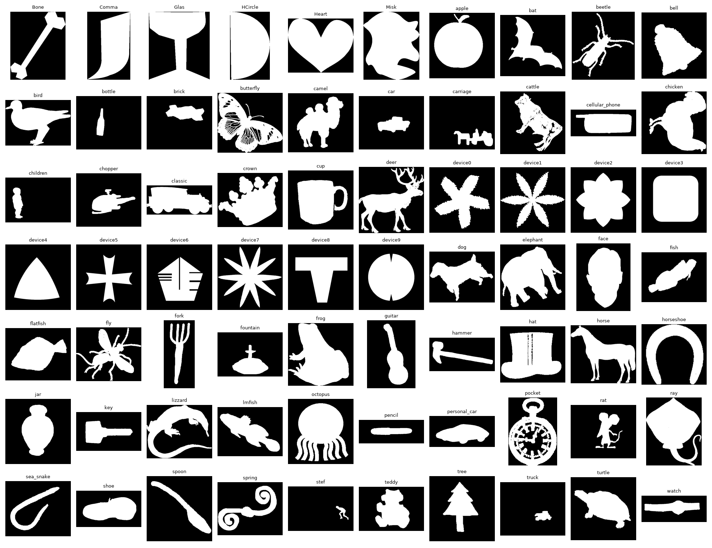
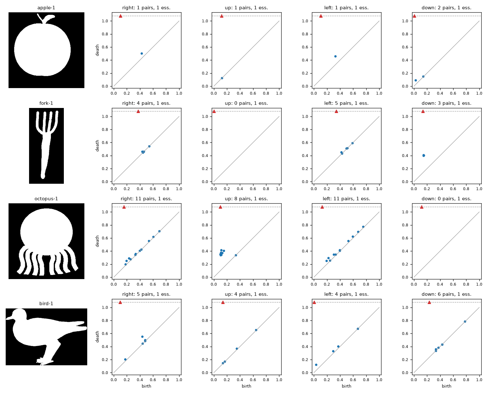

# Deep Learning with Topological Signatures

A from-scratch PyTorch reproduction of Hofer et al., [*Deep Learning with Topological Signatures*](https://arxiv.org/abs/1707.04041) (NeurIPS 2017), on the MPEG-7 CE-Shape-1 Part B shape classification task.

## Background

Persistent homology summarises the shape of data as a *persistence diagram*: a set of (birth, death) points, one per topological feature. Diagrams are unordered and vary in size, so they don't fit directly into a neural network. The paper's contribution is an input layer that maps a diagram to a fixed-size vector by evaluating learnable Gaussian-like "structure elements" at every point and summing, with a log transform that makes near-diagonal (low-persistence, noisy) points count for little.

MPEG-7 CE-Shape-1 Part B has 1,400 binary silhouettes, 20 from each of 70 classes. One example per class:



Each shape is filtered by height along 32 directions, giving 32 H0 diagrams per image. Below are four of those directions for a few shapes. Blue points are components that are born and later merge. The red triangle is the essential class, the component that never dies, drawn above the dashed line.



One structure-element layer per direction (shared with its two neighbouring directions) feeds a small classifier over 70 classes.

## Usage

```bash
pip install -r requirements.txt
python compute_diagrams.py MPEG7 diagrams_lcc.pkl   # MPEG-7 images in ./MPEG7 (not included)
python train.py
```

## Status

Work in progress. Best result so far is 85.4% test accuracy (one seed) against the paper's 91.8%.
