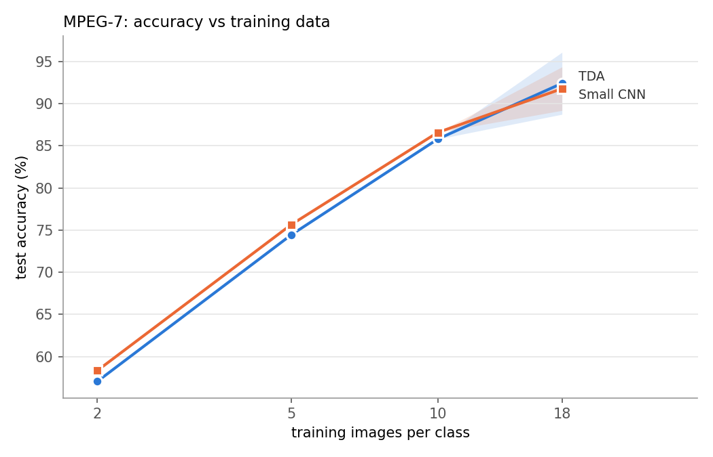

# Deep Learning with Topological Signatures

A from-scratch PyTorch reproduction of Hofer et al., [*Deep Learning with Topological Signatures*](https://arxiv.org/abs/1707.04041) (NeurIPS 2017), on MPEG-7 shape classification, and a fair test of whether the topological features add anything a CNN doesn't.

## Background

Persistent homology summarises the shape of data as a *persistence diagram*: a set of (birth, death) points, one per topological feature. Diagrams are unordered and vary in size, so they don't fit directly into a neural network. The paper's contribution is an input layer that maps a diagram to a fixed-size vector. It evaluates learnable Gaussian-like "structure elements" at every point and sums the results, with a log transform that makes near-diagonal (low-persistence, noisy) points count for little.

MPEG-7 CE-Shape-1 Part B has 1,400 binary silhouettes, 20 from each of 70 classes. One example per class:


## Method

**Diagrams.** Each mask is reduced to its largest connected component and filtered by height along 32 evenly spaced directions. Heights are measured from the shape's barycentre and scaled to [0, 1], which removes position and size. Each direction gives one H0 diagram. Pairs with persistence ≤ 0.01 are dropped, and the essential point, the component that never dies, is kept as the pair (birth, highest height). Four of the 32 directions for a few shapes:


Blue points are components that are born and later merge. The red triangle is the essential point, drawn above the dashed line.

**Network.** One branch per direction looks at the diagrams of that direction and its two neighbours. Each branch has a structure-element layer with 75 elements, 1×1 convolutions across the three views, a max over channels, and a small MLP that outputs 25 features. The 32 × 25 features feed a classifier head with 70 outputs. That's 184K parameters in total.

**Training and evaluation.** SGD (lr 0.1, momentum 0.7, batch size 128), 300 epochs, lr halved every 20 epochs. Each seed is a different stratified 90/10 split (18 training and 2 test images per class). The score is the mean test accuracy over the last 10 epochs. All results are mean ± sample std over seeds 0–4.

## Setup and usage

The MPEG-7 images are not included. Put the dataset's `.gif` files in `./MPEG7`.

```bash
pip install -r requirements.txt
```

**Reproduce the paper:**

```bash
python compute_diagrams.py MPEG7 diagrams_lcc.pkl
python train.py
```

**Baselines** (same splits and score as `train.py`):

```bash
python resnet_baseline.py --arch small --epochs 50 --log small_log.json         # CNN the size of the TDA model
python resnet_baseline.py --epochs 50 --log resnet18_log.json                   # ResNet-18 from scratch
python resnet_baseline.py --pretrained --epochs 50 --log pretrained_log.json    # ResNet-18, ImageNet weights
```

Each command trains on one split; pass `--seed 0` to `--seed 4` (and a matching `--log`) for the others.

**Error analysis** (logs from the same seed, here seed 3):

```bash
python train.py --seed 3 --log train_log_seed3.json
python resnet_baseline.py --arch small --epochs 50 --seed 3 --log small_log_seed3.json
python resnet_baseline.py --epochs 50 --seed 3 --log resnet18_log_seed3.json
python compare_errors.py tda=train_log_seed3.json small=small_log_seed3.json resnet18=resnet18_log_seed3.json
```

## Results

### Reproduction and baselines

The CNNs were trained on the silhouettes themselves: each one cropped to its bounding box, padded to a square and resized to 128 × 128. They use the same protocol and the same 5 splits as the topological model.

| Model | Parameters | Pretraining | Test accuracy |
|---|---|---|---|
| Hofer et al. (paper) | – | none | 91.8% |
| **Topological signatures (this repo)** | 184K | none | **92.5 ± 3.2%** |
| Small CNN (4 conv blocks) | 176K | none | 91.4 ± 2.2% |
| ResNet-18 | 11.2M | none | 91.1 ± 1.9% |
| ResNet-18 | 11.2M | ImageNet | 98.0 ± 1.0% |

<details>
<summary>Per split (seeds 0–4)</summary>

| Model | 0 | 1 | 2 | 3 | 4 |
|---|---|---|---|---|---|
| Topological signatures | 92.8 | 93.6 | 96.5 | 87.7 | 91.8 |
| Small CNN | 89.4 | 93.4 | 92.6 | 92.9 | 88.7 |
| ResNet-18 | 89.3 | 89.3 | 93.0 | 93.2 | 90.9 |
| ResNet-18, pretrained | 97.0 | 98.9 | 99.3 | 97.1 | 97.8 |

</details>

- Without outside data, the topological model is on par with CNNs. It leads the matched-size CNN on 4 of 5 splits, but by only +1.1 points on average, which a paired t-test can't tell from noise (p = 0.56). The same holds against ResNet-18.
- With the full training set, size makes no difference. The small CNN matches ResNet-18 with 64× fewer parameters. ResNet-18 from scratch reaches 100% train accuracy, so its extra capacity goes into memorising.
- ImageNet pretraining is the only clear gain. It beats every other model on every split.

### Less training data

Both small models were retrained on 2, 5 and 10 images per class, on seed 0 only. These are nested subsets of that split's training images, tested on the same test images, with the epochs scaled so every run takes about as many SGD steps as a full one. The points at 18 images per class are the full-data results above, averaged over seeds 0–4 (the band is ± one std):



At every size the two models are within about 1 point (1–2 test images) of each other, from ~57% at 2 images per class to ~86% at 10. Neither is more data-efficient.

### Where the topological model fails

On seed 3 the topological model drops to 87.7%, while both CNNs score about 93%. It gets 17 of 140 test images wrong (small CNN 7, ResNet-18 8). 12 of the 17 are its alone, and they fall into clear groups:

- **(Nearly) convex shapes.** On a convex shape every height sublevel set is connected, so the H0 diagram holds nothing but the shape's extent.
- **Many-legged animals.** A beetle, a fly and a lizard are all called deer. The legs show up as protrusions of some length, but the diagrams don't record where they attach.

A majority vote of the three models makes as many errors as the small CNN alone (7). On this split the topological model adds errors rather than correcting the CNN's.

## Conclusion

The reproduction works: 92.5 ± 3.2% against the paper's 91.8%. Compared fairly, with the same splits, the same score and no outside data, topological signatures match a CNN of the same size but don't beat it. That holds with the full training set and with less data, and they don't correct the CNN's errors.

On this task the representation is as good as learned convolutional features, it is interpretable, and its limits can be predicted from the theory. It gives no measurable advantage, though, and ImageNet pretraining (98.0%) beats both.

## References

- C. Hofer, R. Kwitt, M. Niethammer, A. Uhl. [Deep Learning with Topological Signatures](https://arxiv.org/abs/1707.04041). NeurIPS 2017.
- Authors' code (deprecated, used here only to check implementation details): [c-hofer/nips2017](https://github.com/c-hofer/nips2017)
- [GUDHI](https://gudhi.inria.fr/), used to cross-check the hand-written H0 computation.

Released under the [MIT License](LICENSE).
